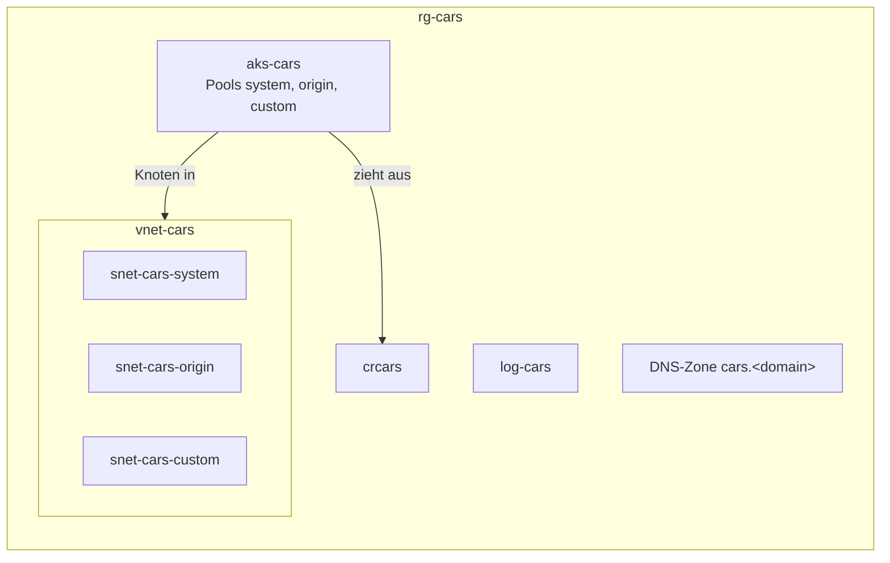

<!--
@license
Copyright (c) rljson

Use of this source code is governed by terms that can be
found in the LICENSE file in the root of this package.
-->

# cars-infra

[English](README.md) | Deutsch

Die Azure-Ressourcen der cars-Anwendung, einer Beispiel-App auf Rljson:
Node.js-Skripte zum Vorbereiten, Ausrollen und Testen und eine
Bicep-Komponente je Ressource, darunter der Kubernetes-Cluster.

## Motivation

- Jede Azure-Ressource von cars ist in Git beschrieben, so lässt sie sich
  allein aus diesem Repo neu aufbauen
- Jedes Deployment zeigt zuerst ein What-if und wird erst nach einem Ja
  angewendet
- Was auf diesen Ressourcen läuft, liegt in
  [cars-deployment](https://github.com/rljson/cars-deployment); so berührt
  eine Änderung an einem Image nie die Azure-Ressourcen

## Aufbau

| Pfad                     | Inhalt                                                                         |
| ------------------------ | ------------------------------------------------------------------------------ |
| `bootstrap/bootstrap.js` | Einmal: registriert die Ressourcenanbieter, legt die Gruppe `rg-cars` an       |
| `deploy.js`              | Rollt eine Komponente oder alle in `rg-cars` aus                               |
| `test.js`                | Führt die Unit-Tests von `lib` aus und baut jede Bicep- und Parameterdatei     |
| `lib`                    | Einstellungen und Prüfungen, die die Skripte teilen, mit ihren Tests           |
| `bicep`                  | Ein Ordner je Komponente: `main.bicep` und `<component>.bicepparam`            |

Alle Ressourcen liegen in einer Ressourcengruppe `rg-cars` in Germany
West Central und dienen den Stufen `dev`, `test` und `prod` gemeinsam:
ein Kubernetes-Cluster `aks-cars`, eine Registry, ein Netz, ein
Log-Analytics-Arbeitsbereich und eine DNS-Zone, dazu eine Logic App, die
den Cluster jeden Abend stoppt. Was die Stufen und die
Seiten im Cluster trennt, Namespaces, Quoten und Netzwerkrichtlinien,
gehört nicht zu diesem Repo.



## Verwendung

Einmal [Node.js](https://nodejs.org) 22 oder neuer, die
[Azure CLI](https://learn.microsoft.com/cli/azure/install-azure-cli) und
ihre Bicep CLI installieren:

```bash
az bicep install
```

Zuerst mit dem eigenen Entra-Konto anmelden; der Betreiber braucht die
Gruppe `cars-admins` oder `cars-operators`.

```bash
az login
az account set --subscription cars
```

Das Abonnement einmal vorbereiten:

```bash
node bootstrap/bootstrap.js
```

Alle Komponenten der Reihe nach ausrollen; jede zeigt zuerst ihr What-if,
und nichts ändert sich vor deinem Ja:

```bash
node deploy.js all
```

Eine Komponente ausrollen oder nur die Änderungen zeigen:

```bash
node deploy.js network
node deploy.js network --what-if
```

`--yes` wendet nach dem What-if ohne Rückfrage an, für Läufe ohne
Terminal. Die Skripte prüfen zuerst das aktive Abonnement. Jede Ressource
bekommt das Tag `techresponsibility` mit dem angemeldeten Benutzer. Die
Komponente `aks` gibt den Gruppen `cars-admins` und `cars-operators`
Admin-Rechte im Cluster; `deploy.js` sucht ihre Objekt-IDs über den Namen.

`dns` wird nur für eine eigene Domain gebraucht; bis dahin nutzen die
Apps die kostenlosen Azure-Namen
`cars-<stage>.germanywestcentral.cloudapp.azure.com` ihrer Gateways, die
nicht zu diesem Repo gehören. `dns` kommt in `deploy.js all` zuletzt,
schlägt also erst fehl, wenn alle anderen Komponenten ausgerollt sind.
Bevor `dns` ausgerollt werden kann, muss `bicep/dns/dns.bicepparam` die
Zone nennen. Nach dem Ausrollen die Namensserver aus ihrer Ausgabe als
NS-Einträge in die übergeordnete Domain eintragen.

Mit dem Entra-Konto am Cluster anmelden:

```bash
az aks get-credentials --resource-group rg-cars --name aks-cars
kubelogin convert-kubeconfig -l azurecli
```

Die Komponente `aks-schedule` stoppt den Cluster jeden Tag um 20:00
Berliner Zeit. Vor der Arbeit damit von Hand starten; das dauert einige
Minuten:

```bash
az aks start --resource-group rg-cars --name aks-cars
```

## Test

Vor jedem Commit:

```bash
node test.js
```

## Grenzen

- Noch keine CI: Betreiber rollen von Hand von ihrem Rechner aus; die
  GitHub-Actions-Workflows werden dieselben Skripte aufrufen
- Noch keine Datenbanken, kein Speicher und keine Workload-Identitäten der
  Apps
- Der Cluster stoppt jeden Abend um 20:00 und läuft erst nach einem
  `az aks start` von Hand wieder, bis dahin sind die Apps aller Stufen,
  auch prod, offline. Tag und Nacht laufend kostet ein Knoten je Pool zu
  Listenpreisen etwa 90 bis 200 USD im Monat; gestoppt kosten nur die
  Datenträger, die öffentliche IP und der Load Balancer, etwa 20 USD im
  Monat. Die Steuerungsebene ist im Free-Tarif, ohne
  Verfügbarkeitszusage

## Stand

| Komponente           | Ressourcen                                                        | Ausgerollt |
| -------------------- | ----------------------------------------------------------------- | ---------- |
| `log-analytics`      | `log-cars`                                                        | ja         |
| `container-registry` | `crcars`                                                          | ja         |
| `network`            | `vnet-cars`, `snet-cars-<pool>`, `nsg-cars-<pool>`                | ja         |
| `aks`                | `aks-cars`, `id-aks-cars`, Knoten-Ressourcengruppe `rg-cars-aks`  | ja         |
| `aks-schedule`       | `logic-aks-cars-stop`                                             | ja         |
| `dns`                | die Zone `cars.<domain>`                                          | nein       |

`dns` wird nicht gebraucht, solange die kostenlosen Azure-Namen genutzt
werden.
