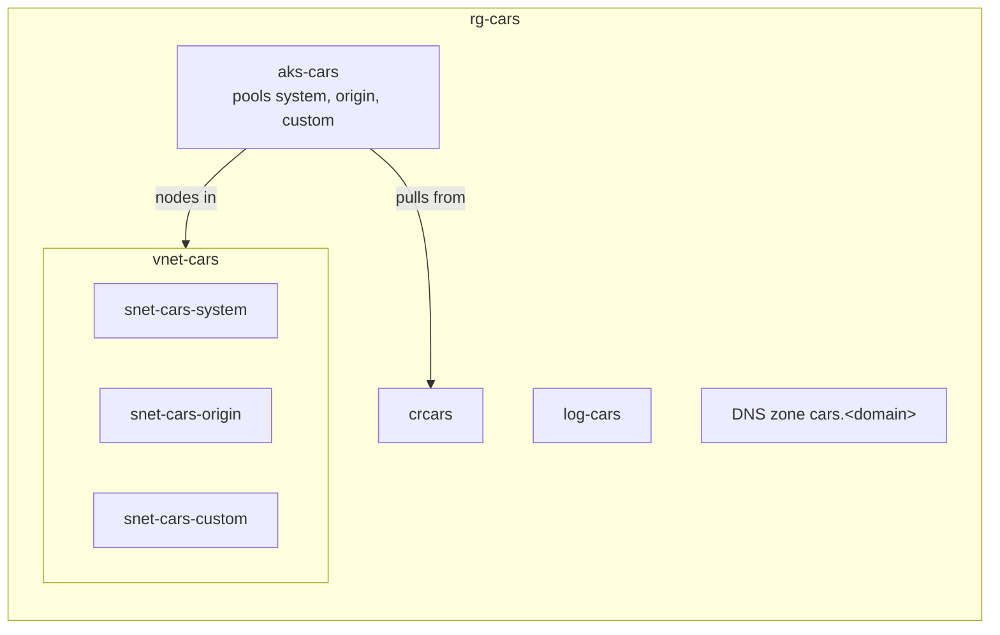

<!--
@license
Copyright (c) rljson

Use of this source code is governed by terms that can be
found in the LICENSE file in the root of this package.
-->

# cars-infra

English | [Deutsch](README.de.md)

The Azure resources of the cars application, an example app built on
Rljson: Node.js scripts to bootstrap, deploy and test, and one Bicep
component per resource, among them the Kubernetes cluster.

## Motivation

- Every Azure resource of cars is described in git, so it can be rebuilt
  from this repo alone
- Each deploy shows a what-if first and applies only after a yes
- What runs on these resources lives in
  [cars-deployment](https://github.com/rljson/cars-deployment), so a
  change to an image never touches the Azure resources

## Layout

| Path                     | Content                                                                  |
| ------------------------ | ------------------------------------------------------------------------ |
| `bootstrap/bootstrap.js` | Run once: registers the resource providers, creates the group `rg-cars`  |
| `deploy.js`              | Deploys one component or all of them into `rg-cars`                      |
| `test.js`                | Runs the unit tests of `lib` and builds every Bicep and parameter file   |
| `lib`                    | Settings and checks shared by the scripts, with their tests              |
| `bicep`                  | One folder per component: `main.bicep` and `<component>.bicepparam`      |

All resources live in one resource group `rg-cars` in Germany West
Central and serve the stages `dev`, `stage` and `prod` together: one
Kubernetes cluster `aks-cars`, one registry, one network, one Log
Analytics workspace and one DNS zone. What separates the stages and the
sides inside the cluster, namespaces, quotas and network policies, is not
part of this repo.



## Usage

Install [Node.js](https://nodejs.org) 22 or later, the
[Azure CLI](https://learn.microsoft.com/cli/azure/install-azure-cli) and
its Bicep CLI once:

```bash
az bicep install
```

Sign in with your own Entra account first; the operator needs the group
`cars-admins` or `cars-operators`.

```bash
az login
az account set --subscription cars
```

Prepare the subscription once:

```bash
node bootstrap/bootstrap.js
```

Deploy all components in order; each shows its what-if first and nothing
changes before your yes:

```bash
node deploy.js all
```

Deploy one component, or only show the changes:

```bash
node deploy.js network
node deploy.js network --what-if
```

`--yes` applies after the what-if without asking, for runs without a
terminal. The scripts check the active subscription first. Every resource
gets the tag `techresponsibility` with the signed-in user. The component
`aks` gives the groups `cars-admins` and `cars-operators` admin rights in
the cluster; `deploy.js` looks up their object IDs by name.

Before `dns` can be deployed, `bicep/dns/dns.bicepparam` must name the
zone. After the deploy, add the name servers of its output as NS records
to the parent domain.

Sign in to the cluster with your Entra account:

```bash
az aks get-credentials --resource-group rg-cars --name aks-cars
kubelogin convert-kubeconfig -l azurecli
```

## Test

Before each commit:

```bash
node test.js
```

## Limitations

- No CI yet: operators deploy by hand from their machine; the GitHub
  Actions workflows will call the same scripts
- No databases, storage or workload identities of the apps yet
- The cluster runs day and night; with one node per pool it costs about
  90 to 200 USD a month at list prices, plus about 20 USD for the load
  balancer. The control plane is in the Free tier, without an uptime SLA

## Status

| Component            | Resources                                                         | Deployed |
| -------------------- | ----------------------------------------------------------------- | -------- |
| `log-analytics`      | `log-cars`                                                        | yes      |
| `container-registry` | `crcars`                                                          | yes      |
| `network`            | `vnet-cars`, `snet-cars-<pool>`, `nsg-cars-<pool>`                | yes      |
| `dns`                | the zone `cars.<domain>`                                          | no       |
| `aks`                | `aks-cars`, `id-aks-cars`, node resource group `rg-cars-aks`      | yes      |

`dns` waits for the name of the domain.
